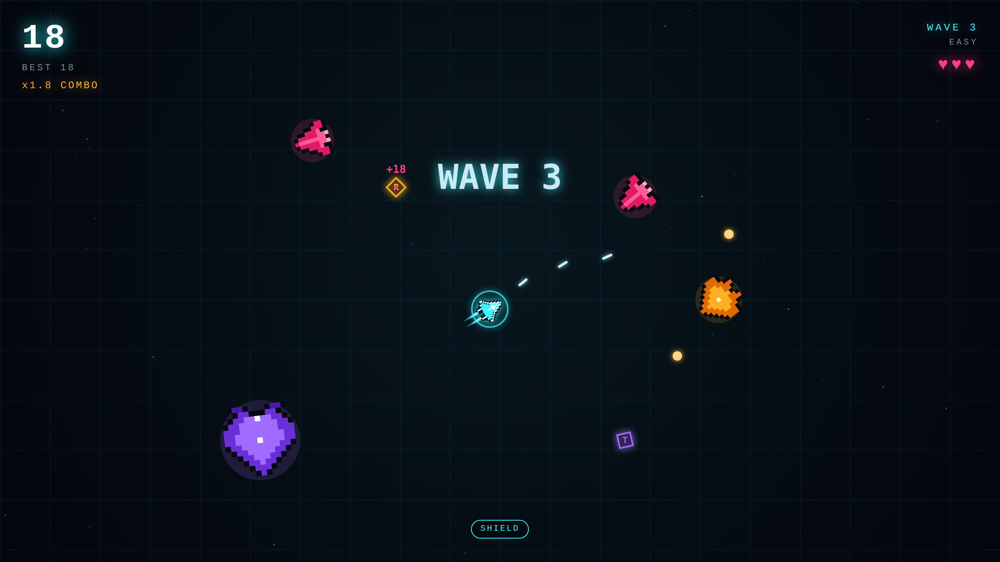

# Neon Defender

A tiny neon arena shooter that runs in a single browser tab. No build step, no dependencies, no image or audio assets — just three files.

**Play it:** https://oscarthewhitehathacker.github.io/neon-defender/



## How to play

| Action | Control |
| --- | --- |
| Move | `WASD` / arrow keys |
| Fire | Mouse (hold) or `Space` |
| Difficulty | `1` `2` `3` on the menu, or the EASY / MEDIUM / HARD pills |
| Pause | `P` or `Esc` |
| Mute | `M` |

On touch screens: drag anywhere to move, the turret auto-fires at the nearest enemy.

## Difficulty

Pick a mode on the menu before you launch — the choice is remembered between
sessions. Only enemy movement speed changes; wave size, health and spawn pacing
are identical, so scores stay comparable.

| Mode | Enemy speed | Feel |
| --- | --- | --- |
| EASY | x1.15 | Slightly faster than the original build |
| MEDIUM | x1.55 | Quite fast |
| HARD | x2.05 | Very fast — chasers close in from every side |

## Waves

Every wave is harder than the last: wave size, enemy health and enemy size all
creep up, and each cleared wave makes the swarm **125% as fast as the wave
before it** (x1.25 compounding — x1 in wave 1, x1.25 in wave 2, x1.56 in wave 3,
x1.95 by wave 4). The ramp multiplies on top of the difficulty setting, so HARD
gets very fast very quickly.

## What's in it

- Three enemy types — chasers, strafing shooters, and tanks that split into grunts when destroyed
- Three difficulty levels — easy, medium and hard, each with a distinct enemy speed
- Endless waves that scale in count, health, enemy size and enemy speed (+125% per wave)
- Enemy bodies measured against the arena, so the same enemy fills the same share of the screen on a phone or a 4K monitor
- Combo multiplier for chained kills
- Pickups: rapid fire, triple shot, shield, extra life
- High score saved to `localStorage`
- Particles, screen shake, procedural WebAudio blips — zero asset files
- Responsive canvas with device-pixel-ratio scaling, works on phone and desktop

## Run locally

```bash
git clone https://github.com/OscarTheWhiteHatHacker/neon-defender.git
cd neon-defender
python3 -m http.server 8080
# open http://localhost:8080
```

Opening `index.html` directly with `file://` also works.

## Structure

```
index.html   markup + HUD
style.css    neon UI, overlay panels, responsive layout
game.js      the whole game — loop, entities, waves, rendering, audio
```

## License

MIT
